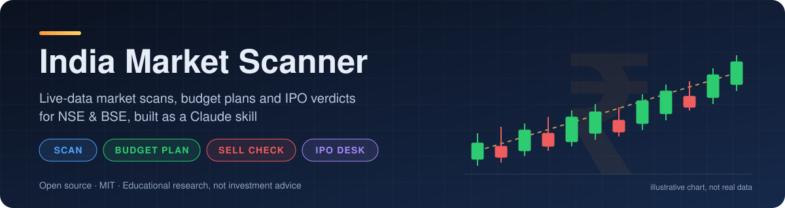
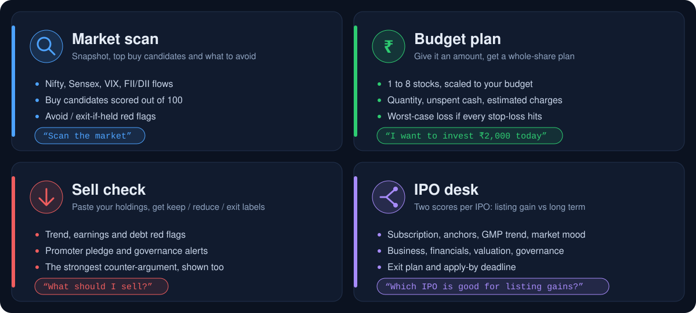
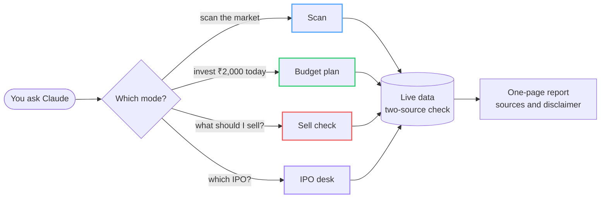
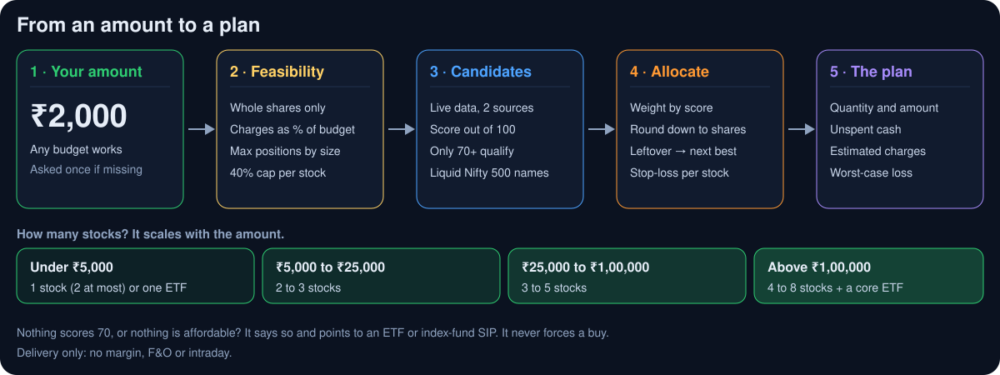
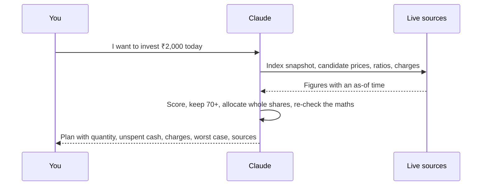
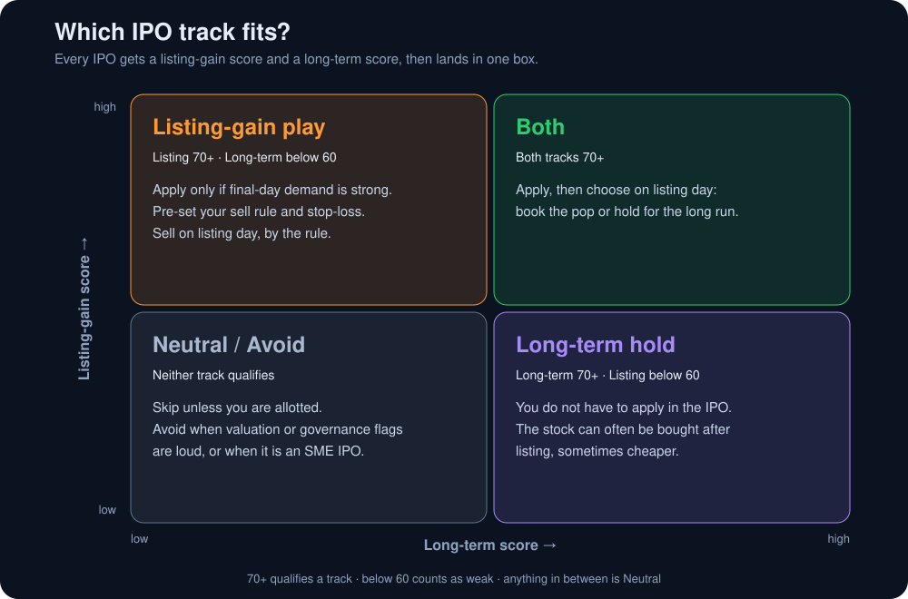
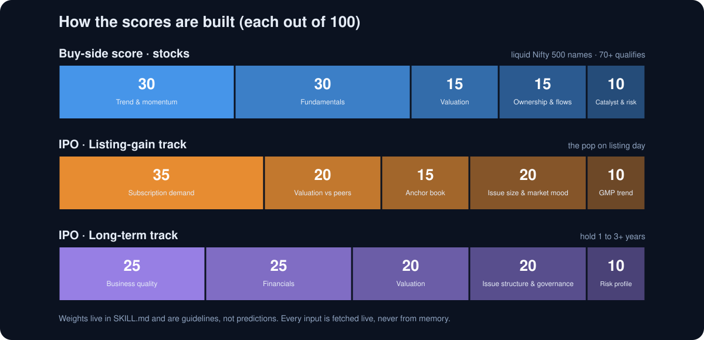
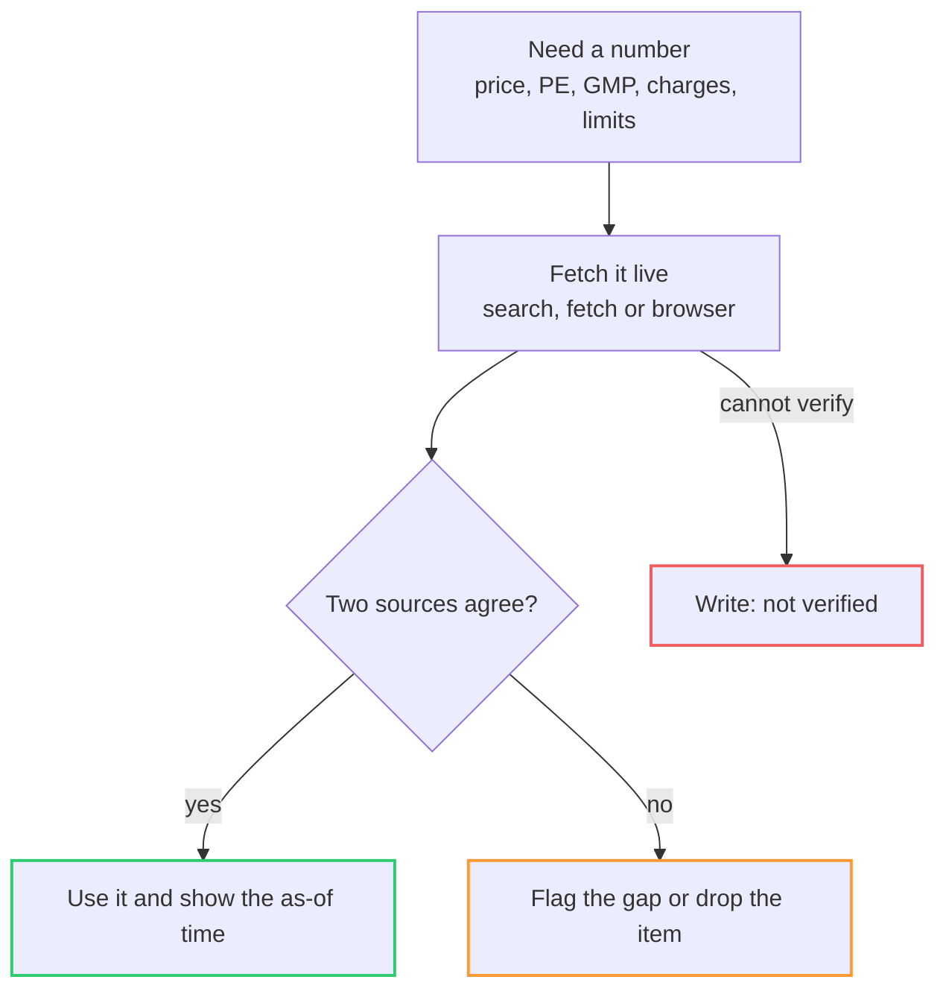

<p align="center">
  
</p>

# India Market Scanner: Indian Stock Market Scanner Skill for Claude (NSE and BSE)

<p align="center">
  
  
  
  
</p>

<p align="center">
  <a href="#features">Features</a> ·
  <a href="#budget-plan">Budget plan</a> ·
  <a href="#ipo-desk">IPO desk</a> ·
  <a href="#how-the-scores-are-built">Scoring</a> ·
  <a href="#sell-check">Sell check</a> ·
  <a href="#no-made-up-numbers">Trust model</a> ·
  <a href="#faq">FAQ</a> ·
  <a href="#install">Install</a> ·
  <a href="#disclaimer">Disclaimer</a>
</p>

> [!WARNING]
> **Educational research tool, not investment advice.** It is not a SEBI-registered investment adviser or research analyst. Everything it produces is a screen-based candidate or an illustrative allocation, never an instruction to buy or sell. Read the full [disclaimer](#disclaimer).

**India Market Scanner** is a free, open-source **Claude skill** (an [Agent Skill](https://docs.claude.com)) that works as an **Indian stock market scanner** for **NSE and BSE**. Ask in plain English and it scans Nifty and Sensex stocks with live data, turns a budget like ₹2,000 into a whole-share plan, checks your holdings for red flags, and sorts every IPO into **listing gain** or **long term**. It runs in Claude Code and the Claude app.

## Features

<p align="center">
  
</p>

| You say | Mode | You get |
|---|---|---|
| "Scan the market" | 📈 **Scan** | Market snapshot, top buy candidates, an avoid list and IPO tables |
| "I want to invest ₹2,000 today" | 💰 **Budget plan** | Whole-share allocation, unspent cash, estimated charges, worst-case loss |
| "What should I sell?" + your holdings | 🔻 **Sell check** | Hold / trim / exit label for each holding, with the counter-argument |
| "Which IPO is good for listing gains?" | 🚀 **IPO desk** | Two scores per IPO, a verdict, an exit plan and the apply-by deadline |

You never pick a mode. The skill reads your request and routes it:



## Budget plan

Give it any amount. It checks what is actually feasible at that size, picks from live candidates that score 70 or more, and rounds everything down to whole shares.

<p align="center">
  
</p>



**What the answer looks like.** *Illustrative format only: the companies and numbers below are fictional.*

**Budget ₹2,000 · delivery · 3 to 12 months · moderate risk · prices as of the time shown in the real report**

| Stock | CMP | Qty | Amount | % of budget | Why | Stop-loss | Horizon |
|---|---|---|---|---|---|---|---|
| Alpha Engineering | ₹640 | 2 | ₹1,280 | 64% | Order book growing, ROCE above 15%, above a rising 200-DMA | ₹590 | 3 to 12 months |
| Beta Foods | ₹350 | 2 | ₹700 | 35% | Low debt, steady margins, PE below peers | ₹322 | 3 to 12 months |

**Invested** ₹1,980 · **Unspent** ₹20 · **Estimated round-trip charges** looked up for your broker and shown in ₹ and % · **Worst case if both stops hit** ₹156 (7.8% of the budget)

*Why this mix:* two different sectors and two different reasons to own them. *What would change the plan:* a close below either stop-loss, or the market turning risk-off.

**What keeps small budgets honest**

- 🧮 **Whole shares only.** NSE/BSE direct equity has no fractional shares, so quantity is the allocation divided by price, rounded down. A share that costs more than its slice is skipped, and the leftover cash goes to the next-best affordable pick.
- 💸 **Charges are counted.** Brokerage, STT, exchange and DP charges bite harder on small amounts. They are looked up for your broker, never quoted from memory, and shown in ₹ and as a % of the budget. Above about 2%, the skill says so and offers a cheaper route (one position, a Nifty 50 ETF or an index-fund SIP).
- 🎯 **Concentration limits.** Fewer positions for small budgets, a 40% cap per stock once there are 3 or more, and at most 2 names from one sector.
- 🛑 **Worst case is shown.** The loss if every stop-loss hits, in ₹ and %, flagged when it passes about 10%.
- 🚫 **No margin, F&O or intraday.** Delivery buys only.
- ⏸️ **Never forces a buy.** If nothing scores 70, or nothing is affordable, it says so.

## IPO desk

Every mainboard IPO is scored on two separate tracks, so a quick listing pop and a business worth holding are never confused.

<p align="center">
  
</p>

**What the answer looks like.** *Illustrative format only: the IPOs and scores below are fictional.*

| IPO | Verdict | Listing | Long-term | Why | Action |
|---|---|---|---|---|---|
| Nova Foods | 🟠 Listing-gain play | 82 | 48 | QIB and NII heavily oversubscribed, priced below peers, small issue; margins are thin | Apply only if the lot fits your budget, sell on listing day by your rule |
| Orbit Cables | 🟣 Long-term hold | 51 | 77 | Strong financials, fair valuation, mostly fresh issue; subscription is weak | Skip the IPO, consider buying after listing |
| Helio Pharma | 🟢 Both | 74 | 72 | Solid demand and a reasonable valuation with clean governance | Apply, then choose on listing day: book the pop or hold |
| Zeta Logistics | 🔴 Avoid | 33 | 29 | OFS-heavy exit by a PE investor, valuation stretched against peers | Skip |

**Good to know**

- **Lot cost decides who can apply.** The minimum application is one lot at the upper price band. Many mainboard lots cost far more than a small budget, and the skill says so plainly instead of stretching.
- **Allotment is a lottery.** At N times retail subscription the odds are roughly 1 in N per application, so a hot IPO means low odds.
- **A long-term case does not require applying.** The stock can usually be bought after listing, sometimes cheaper.
- **GMP is supporting evidence only.** It is unofficial and can be manipulated.
- **SME IPOs default to Avoid** because of large lot sizes and thin liquidity.
- **Every IPO gets an exit plan.** A sell-on-listing rule and stop for listing-gain plays, and what to monitor for long-term holds.

## How the scores are built

<p align="center">
  
</p>

- **Buy-side stocks** come from liquid Nifty 500 names. ASM/GSM, T2T, SME and penny stocks are excluded, and stocks stretched more than 20% above their 50-DMA are penalised. Only scores of 70 or more qualify.
- **Every pick** shows an entry zone, a technical stop-loss, a first target, a risk-to-reward ratio (dropped if below 1:2) and what would prove the setup wrong.
- **No clean setup?** The skill says "no clean setups today" instead of padding the list.

## Sell check

Paste your holdings as a list, CSV or screenshot, or ask for an avoid list. Each holding gets a **hold / trim / exit** label, the evidence behind it and the strongest counter-argument.

| Red flag | What it looks for |
|---|---|
| 📉 Broken trend | Close below the 200-DMA with lower highs |
| 🧾 Falling earnings | Two or more quarters of shrinking profit or margins |
| 💳 Debt stress | Rising debt or weak interest coverage |
| 🔐 Promoter pledge | Pledge above 25%, or promoter selling |
| 🚩 Governance | Auditor resignation, delayed results, qualified opinion, SEBI/ED/CBI action, rating downgrade |
| 🏷️ Stretched valuation | Price far ahead of growth |
| 🏦 Smart money leaving | Persistent FII or mutual-fund selling, negative bulk deals |

It also reminds you to check the tax impact (STCG/LTCG) before selling, and never suggests leveraged shorts.

## No made-up numbers

Prices move and rules change, so the skill treats every figure as something to fetch, not recall.



- Prefers primary sources: exchange filings, results, SEBI-filed RHP/DRHP, NSE/BSE bulk and block deal data.
- Treats social-media tips and "target price" headlines as noise.
- Recomputes every quantity, total and percentage before showing it.
- Never places trades, logs into broker accounts or handles credentials.

## FAQ

### What is the India Market Scanner?

A free, open-source Claude skill: a Markdown instruction file that teaches Claude to act as an Indian stock market scanner for NSE and BSE, covering market scans, budget plans, sell checks and IPO verdicts.

### Is there a Claude skill for the Indian stock market?

Yes, this one. Install it in Claude Code or the Claude app, then ask things like "scan the market" or "I want to invest ₹2,000 today".

### How do I scan NSE and BSE stocks with Claude?

Install the skill, enable web access, and ask "scan the market". It fetches Nifty, Sensex, India VIX and FII/DII flows live, scores liquid Nifty 500 stocks out of 100, and returns buy candidates and an avoid list with sources.

### Can it suggest stocks for a small budget like ₹2,000?

Yes. It builds an illustrative whole-share plan across 1 to 8 stocks depending on the amount, shows unspent cash, estimated charges and the worst-case loss, and says when an ETF or index-fund SIP fits better. It never forces a buy.

### Which IPO is good for listing gains, and which is for the long term?

Each mainboard IPO gets two scores: listing gain (subscription, anchors, valuation vs peers, GMP trend, market mood) and long term (business, financials, valuation, governance). The verdict is Listing-gain play, Long-term hold, Both, Neutral or Avoid.

### Is it free, and is it investment advice?

It is free and MIT licensed. It is not investment advice, and it is not a SEBI-registered adviser or research analyst. Outputs are screen-based candidates for you to verify.

### Where does the data come from?

Live web sources fetched in each session, such as exchange pages, filings, Screener.in, Moneycontrol and Chittorgarh. Figures are cross-checked and shown with an as-of time, and anything it cannot verify is marked "not verified".

## Install

**Claude Code**

```bash
git clone https://github.com/haarsh24/india-market-scanner.git
cp -r india-market-scanner/skills/india-market-scanner ~/.claude/skills/
```

**Claude (web / desktop app)**

Zip the `skills/india-market-scanner` folder (so `SKILL.md` sits inside it) and upload it from the Skills section of Claude's settings.

Web access (search and fetch) must be enabled so the skill can get live data.

## Usage

- "Scan the market"
- "Stocks to buy today"
- "I want to invest ₹2,000 today, what should I buy?"
- "I have ₹25,000, split it across a few stocks"
- "What should I sell?" (paste your holdings)
- "Which IPO is good for listing gains?"
- "Which IPO is good for the long term?"
- "Is the [company] IPO worth subscribing to?"

## Limits to know about

- **Small budgets:** a mainboard IPO lot often costs more than a few thousand rupees, and charges take a visible share of a ₹2,000 plan.
- **Data freshness:** free market sites can lag by about 15 minutes, so every price carries an "as of" time.
- **Closed market:** outside 9:15 to 15:30 IST, plans use the last close and the next open can gap.
- **Not a forecast:** scores rank candidates from today's data. They do not predict returns.

## Repo layout

```
india-market-scanner/
├── LICENSE
├── README.md
├── CITATION.cff
├── assets/
│   ├── banner.svg
│   ├── modes.svg
│   ├── budget-flow.svg
│   ├── ipo-matrix.svg
│   ├── scoring.svg
│   └── social-preview.svg / .png
├── docs/                   landing page for GitHub Pages
│   ├── index.html
│   ├── sitemap.xml
│   └── assets/
└── skills/
    └── india-market-scanner/
        └── SKILL.md
```

## Contributing

Issues and pull requests are welcome, for example better data sources, scoring tweaks or new checks. Please keep the disclaimer and the "verified data only" rule intact.

## Disclaimer

**This is an educational research tool, not investment advice.** It is not a SEBI-registered investment adviser or research analyst. Output is screen-based, may be wrong or stale, and carries no guarantee of returns. Budget plans are illustrative allocations from a screen, not a recommendation to buy. Markets involve risk of loss. Verify all data yourself and consider a SEBI-registered adviser before investing. The authors accept no liability for decisions made using this tool.

## License

[MIT](LICENSE)
